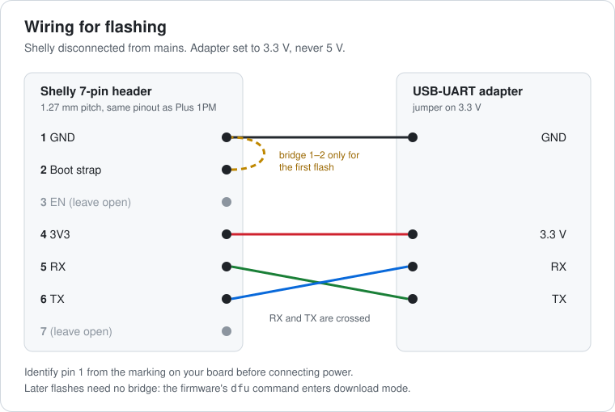
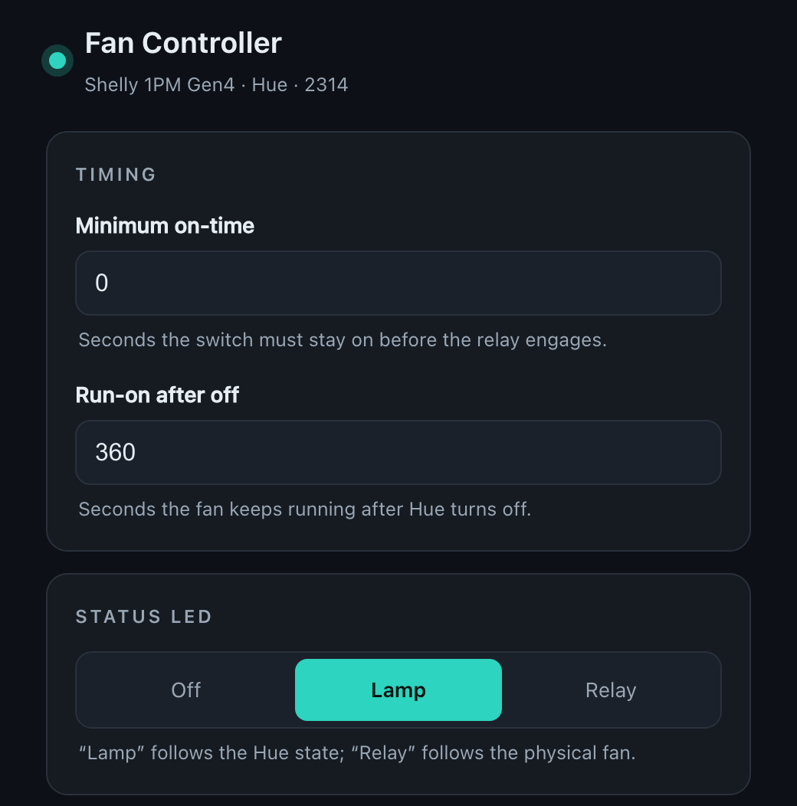
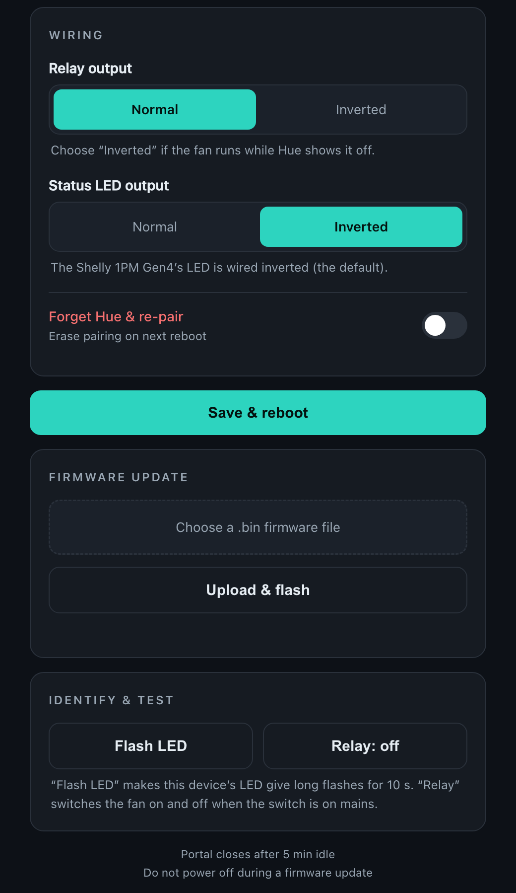

# Shelly 1PM Gen4 → Hue fan controller

Alternative firmware for the **Shelly 1PM Gen4** (ESP32-C6) that makes it appear
to a **Philips Hue Bridge** as an ordinary Hue light, and switches a bathroom fan
with a run-on timer:

- The Hue room turns **on** → the fan starts.
- The Hue room turns **off** → the fan keeps running for 6 minutes, then stops.
- On again during those 6 minutes → the fan keeps running.

Put it in the same Hue room or zone as the bathroom lamp, and the Hue button,
app and automations control lamp and fan together.

Built on [huesmith](https://github.com/canack/huesmith), which provides the
Hue-compatible Zigbee light. This project adds the Shelly hardware layer, the
timer logic, a serial console and a WiFi setup portal.

**Where to start**

- **[Installation](#installation)**: flash a stock Shelly 1PM Gen4 from scratch.
- **[User manual](#user-manual)**: living with the installed switch, changing
  settings, re-pairing.
- **[Reference](#reference)**: serial console, hardware details, how it works.

## Status

Running on a real Shelly 1PM Gen4 (S4SW-001P16EU), tested on the bench.

| Feature | State |
|---|---|
| Pairs with the Hue Bridge, responds to on/off | Verified |
| Run-on logic (seen in the serial log) | Verified on the bench |
| Status LED | Verified |
| Serial console, flashing without a jumper | Verified |
| Setup portal opens after 3 power cycles, page loads on a phone | Verified |
| Setup portal: Save & reboot | Verified |
| Setup portal: network name with device id, Flash LED and Relay buttons | Verified |
| Setup portal: Normal/Inverted wiring choices (replacing the polarity switches) | Built and rendered; saving them not yet tested on the device |
| Re-pairing with the same bridge (automatic new address each time) | Verified, including locally administered addresses |
| Crash right after pairing (Zigbee OTA frame) | Fixed and verified |
| Firmware upload through the setup portal | Not yet completed end to end |
| Relay switching, run-on timing and relay polarity on mains | **Not tested** |
| Onboard button reset at boot | Not tested |

---

## Installation

This takes you from a stock Shelly to a switch paired with your Hue Bridge.
Plan for an hour or two the first time; much of it is waiting for the first
build.

### What you need

- **Shelly 1PM Gen4**, model S4SW-001P16EU. Other Shelly models use other pins.
- **USB-to-UART adapter with 3.3 V logic and a 3.3 V supply pin**, for example a
  CP2102 or CH340 board with a 3.3 V/5 V jumper.
- **Five jumper wires that fit a 1.27 mm header** (finer than the usual
  2.54 mm), or a 1.27 mm pin header or pogo pins.
- **A computer** with macOS or Linux. Everything here was done on macOS.
- **A Philips Hue Bridge.**
- Optional: a 470–1000 µF capacitor if you want to use the WiFi setup portal on
  the bench (see [Setup mode](#changing-settings-setup-mode)).

### Safety

- **The Shelly must be disconnected from mains whenever anything is connected to
  its header.** The header is not isolated from the mains side.
- On the bench, power it only from the adapter's **3.3 V** pin. 5 V can destroy
  the ESP32-C6.
- The relay does not switch on 3.3 V, so relay behaviour can only be checked on
  mains, with the adapter disconnected.
- Mains wiring in a bathroom may be subject to local regulations. If in doubt,
  have an electrician install it.

### 1. Install the toolchain

```bash
curl --proto '=https' --tlsv1.2 -sSf https://sh.rustup.rs | sh
```

```bash
cargo install ldproxy espflash cargo-espflash
```

```bash
pip3 install esptool
```

- The Rust nightly version is pinned in `rust-toolchain.toml` and installed
  automatically on the first build. Later nightlies failed to build `std` for
  this target (see the comment in that file).
- ESP-IDF v5.2.2 is pinned in `.cargo/config.toml` and is downloaded and built
  on the first build.
- Linux: install `libudev-dev` and `pkg-config` first.

### 2. Get the code and build

```bash
git clone https://github.com/weese/shelly-hue-fan.git
```

```bash
cd shelly-hue-fan
```

```bash
cargo build --release
```

The first build downloads and compiles ESP-IDF and takes a long while. Later
builds take seconds.

### 3. Wire the adapter



| Shelly header pin | Signal | Connect to |
|---|---|---|
| 1 | GND | adapter GND |
| 2 | Boot strap | bridge to pin 1, **first flash only** |
| 3 | EN | nothing |
| 4 | 3V3 | adapter 3.3 V |
| 5 | RX | adapter **TX** |
| 6 | TX | adapter **RX** |
| 7 | — | nothing |

The header is described in the
[blakadder template for the Shelly 1PM Gen4](https://templates.blakadder.com/shelly_1PM_Gen4.html).
Its pinout is the same as the Shelly Plus 1PM's, whose
[blakadder page](https://templates.blakadder.com/shelly_plus_1PM.html) has a
photo showing where pin 1 is. Find pin 1 on your board before you connect power.

Plug in the adapter and find its serial port:

```bash
ls /dev/cu.usbserial* /dev/ttyUSB* 2>/dev/null
```

The commands below use `$PORT`. Set it to the port you found, for example:

```bash
export PORT=/dev/cu.usbserial-210
```

### 4. Back up the stock firmware

This backup is your only way back to Shelly's own firmware. With pins 1 and 2
bridged, unplug and replug the adapter so the chip starts in download mode, then:

```bash
tools/backup_flash.sh "$PORT" shelly-1pm-gen4-stock-backup.bin
```

It reads the 8 MB flash in small chunks and retries failed ones, because a single
large read kept aborting over jumper wires. Keep the file private: it contains
your Shelly's device-specific data, and your WiFi password if you ever set the
Shelly up with the Shelly app. `.gitignore` excludes `*.bin` so it can't be
committed by accident.

### 5. Flash

```bash
cargo espflash flash --release --port "$PORT" --before no-reset --after no-reset --baud 115200 --partition-table partitions.csv
```

Then unplug the adapter, **remove the bridge between pins 1 and 2**, and plug it
in again. The LED blinks three times quickly, then slowly: the firmware is
running and waiting to be added to a Hue Bridge.

You can check it over the serial console:

```bash
python3 tools/console.py -p "$PORT" status
```

`factory_new=1 joined=0` is expected at this point.

`--before no-reset --after no-reset` is needed because the header has no reset
lines for the adapter.

### 6. Pair with Hue

Follow [Adding it to a Hue Bridge](#adding-it-to-a-hue-bridge). This works on the
bench; the adapter powers the Zigbee radio fine.

### 7. Test on mains, then install

Disconnect the adapter. In a safe test setup, not yet in the wall box:

1. Hue on → the relay clicks and the fan runs.
2. Hue off → the fan keeps running for the run-on time, then stops.
3. If the fan runs when Hue says off, the relay polarity is inverted. Set
   *Relay output* to *Inverted* in [setup mode](#changing-settings-setup-mode).
4. Open setup mode once and confirm your phone can connect.

Then have it installed.

### Updating the firmware later

No bridge between pins 1 and 2 is needed anymore. The firmware reboots into
download mode on a console command:

```bash
python3 tools/console.py -p "$PORT" dfu
```

```bash
cargo espflash flash --release --port "$PORT" --before no-reset --after no-reset --baud 115200 --partition-table partitions.csv
```

Then **unplug and replug the adapter once**. The chip stays in download mode
across soft resets, and no software way out of it worked.

Flashing over serial keeps the Hue pairing and all settings, as long as
`partitions.csv` is unchanged.

Once installed, the setup portal can install a firmware file instead (see
[Firmware update](#firmware-update)). Build the file with:

```bash
espflash save-image --chip esp32c6 --flash-size 8mb --partition-table partitions.csv target/riscv32imac-esp-espidf/release/shelly-hue-fan firmware.bin
```

Caveat: a serial flash writes the first firmware slot (`ota_0`). After an update
through the portal the device runs from `ota_1`, and a serial flash alone would
then not take effect. In that case also erase the `otadata` partition (espflash
has `--erase-parts`; not tried yet).

### Restoring stock firmware

With the chip in download mode:

```bash
esptool --chip esp32c6 --port "$PORT" --before no-reset --after no-reset write-flash 0x0 shelly-1pm-gen4-stock-backup.bin
```

Not tested.

---

## User manual

For living with the installed switch.

### What it does

The switch shows up in the Hue app as a light. It sits in the same Hue room or
zone as the bathroom lamp, so whatever controls that room also controls the fan:
the Hue button, the app, automations, voice assistants.

- **Room on** → the fan starts.
- **Room off** → the fan keeps running for **6 minutes**, then stops.
- **Room on again within those 6 minutes** → the fan simply keeps running.

The Hue app shows the fan as *off* as soon as you switch off, even though it is
still running out its 6 minutes. That is expected.

After a power cut the fan stays off until it is switched on again. Pairing and
settings are kept.

### The status light

| LED | Meaning |
|---|---|
| 3 quick blinks, then a few seconds of slow blinking | Just powered up. |
| Slow blinking (keeps going) | Not connected to a Hue Bridge; waiting to be added. |
| Fast blinking | Setup mode is open. |
| On / off | Follows the fan's on/off state in Hue (default setting). |

### Changing settings (setup mode)

Settings are changed from a phone, on a small web page served by the switch
itself. No app or internet is needed.

**Open setup mode:** switch the fan's circuit **off and on three times in quick
succession**, using the switch or circuit breaker that powers it. Leave it off for
a few seconds each time so the switch really powers down, and on for no more than
about 5 seconds. After the third time the LED blinks fast.

**Connect:** join the WiFi network **`Shelly-Fan-Setup-XXXX`** (no password). The
four characters `XXXX` belong to your switch: they are the last four hex digits
of its hardware address, so several switches in setup mode don't get mixed up.
The page usually opens by itself. If not, open **192.168.71.1** in a browser.

While your phone is on this network it has no internet and the Hue app doesn't
work. Switch back to your home WiFi when you're done.

<p>
  
  
</p>

At the bottom of the page, **Identify & test** has two buttons that act
immediately and change no settings:

- **Flash LED**: this switch's LED gives long flashes for 10 seconds instead of
  the fast blink, so you can see which switch you're connected to.
- **Relay**: switches the fan on and off directly, for testing the wiring. It
  starts off each time setup mode opens.

| Setting | What it does |
|---|---|
| **Minimum on-time** | Seconds the room must stay on before the fan starts. `0` = immediately. With `60`, a quick visit doesn't start the fan. |
| **Run-on after off** | Seconds the fan keeps running after the room is switched off. Default `360` (6 minutes). |
| **Status LED** | *Off*: always dark. *Lamp*: lit while Hue shows the fan as on. *Relay*: lit while the fan actually runs, including the run-on. |
| **Relay output** | *Normal* or *Inverted*. Set once at installation: if the fan runs when Hue says off, choose *Inverted*. |
| **Status LED output** | *Normal* or *Inverted*. The default (*Inverted*) is right for this switch; change it only if the LED is lit when it should be dark. |
| **Forget Hue & re-pair** | Disconnects from the Hue Bridge so the switch can be added again. See below. |

Press **Save & reboot**. The switch stores the settings and restarts in normal
mode with the new settings. Without any interaction for 5 minutes it leaves setup
mode by itself, changing nothing.

Setup mode uses WiFi, which needs more power than a USB-UART adapter supplies: on
the bench the network appears, but the switch resets as soon as a phone
connects. On mains this isn't an issue. On the bench, a 470–1000 µF capacitor
across 3V3 and GND helps.

### Adding it to a Hue Bridge

1. In the Hue app: **Settings → Add device → Add light → Search**.
2. While the search runs, the switch's LED should be blinking slowly. It joins
   within a few seconds and appears as a new light.
3. Give it a name (e.g. *Bathroom fan*) and put it in the **same room or zone as
   the bathroom lamp**. Check that your Hue button controls that room or zone.

### Re-adding or moving to another bridge

Open setup mode, turn on **Forget Hue & re-pair**, press **Save & reboot**. A few
seconds after the restart the switch disconnects from Hue, restarts again and
blinks slowly. Then add it as described above, on the same bridge or a new one.

Each re-pair gives the switch a new network identity. That is necessary because a
Hue Bridge ignores a light it has seen before, for example after it was deleted
in the app. The old entry in the Hue app becomes unreachable; delete it.

### Firmware update

The setup page can install a firmware file (`.bin`) built from this project:
choose the file, press **Upload & flash**, and **don't switch off the power**
until the switch has restarted.

This hasn't been tested end to end yet. Only use files whose origin you know.

### Troubleshooting

| Problem | What to try |
|---|---|
| The fan keeps running after switching off | Normal for 6 minutes (or whatever *Run-on after off* is set to). |
| The fan does nothing | Check the circuit breaker. Slow blinking means the switch has lost its Hue connection. |
| The fan runs when Hue says off | The relay polarity is wrong. In setup mode, switch *Relay output* to the other setting. |
| Hue shows the fan as unreachable | The switch has no power, or it is too far from the nearest Hue lamp or the bridge. |
| `Shelly-Fan-Setup-…` doesn't appear | The off/on cycles were too slow or too short. Try again: off a few seconds, on briefly, three times. |
| The settings page doesn't open | Check the phone is connected to `Shelly-Fan-Setup-…`, then open `192.168.71.1`. |
| Several switches are in setup mode | Each has its own network name. On the page, **Flash LED** shows which switch you're on. |
| Hue can't find the switch | The LED must be blinking slowly while the app searches. If it was added to this bridge before, use *Forget Hue & re-pair* first. |

The switch is connected to mains. Don't open the cover or the wall box yourself;
leave changes to the wiring to an electrician.

---

## Reference

### Hardware

- **MCU:** ESP32-C6, 8 MB flash.

| Function | GPIO | Used here |
|---|---|---|
| Relay | 4 | drives the fan |
| Status LED | 11 (inverted, LOW = lit) | status indicator |
| Onboard button | 1 | huesmith reset pin at boot |
| Switch input SW | 10 | not used |
| NTC | 3 | not used |
| BL0942 power meter | 6 / 7 | not used |
| UART0 TX / RX | 16 / 17 | console and flashing |

The ESPHome device page lists the LED on GPIO0. That is wrong for this board:
toggling GPIO0 does nothing visible, GPIO11 drives the LED.

Settings are stored in NVS, so they survive firmware updates. Their defaults are
in `Config::default` in `src/config.rs`; fixed pins and the number of power cycles
for setup mode are constants at the top of `src/main.rs`.

### Serial console

The firmware runs a command console on UART0 at 115200 baud. Replies start with
`@@` so they stand out from the log.

```bash
python3 tools/console.py -p "$PORT" status
```

`tools/console.py [-p PORT] [-t SECONDS] [command ...]` sends each command and
prints everything received for the given time (default 4 s). With no command it
just listens.

| Command | Effect |
|---|---|
| `help` | list commands |
| `status` | device id, pairing state, PAN ID, Zigbee address, all settings |
| `reboot` | restart |
| `dfu` | reboot into the ROM bootloader for flashing |
| `repair` | move to a new Zigbee address, leave the network, erase the pairing, reboot |
| `set min_on <s>` | seconds the lamp must stay on before the relay closes |
| `set run_on <s>` | seconds the relay stays closed after the lamp goes off |
| `set led <0\|1\|2>` | LED: 0 off, 1 follows the lamp, 2 follows the relay |
| `set relay_ah <0\|1>` | relay polarity (1 = active-high) |
| `set led_ah <0\|1>` | LED polarity (1 = active-high) |
| `set mac <n>` | choose the Zigbee address offset manually (see below) |
| `aps <0\|1>` | log every incoming Zigbee APS frame (currently on by default) |
| `loglevel <0-5>` | ESP-IDF log level (3 = info, 4 = debug) |

`set` stores the value; it takes effect after `reboot`.

**macOS:** `stty -f PORT 115200` followed by `cat PORT` does not work. The
setting is dropped when `stty` exits and `cat` reads at 9600 baud, which shows
garbage. `tools/console.py` sets the speed on the descriptor it reads from.

The RX pin has its pull-up enabled, so an unconnected RX can't inject characters
once the switch is installed.

### Zigbee address and re-pairing

After a light is deleted in the Hue app, the bridge still lets that device join
its network but never interviews it again, so it never reappears as a light.
Re-pairing therefore always moves the switch to a new IEEE address, chosen by an
offset stored in NVS:

| Offset | Address |
|---|---|
| 0 | the chip's hardware address |
| 1–3 | the chip's other three assigned addresses (ESP32-C6 chips are allocated four consecutive ones) |
| 4–255 | locally administered addresses (U/L bit set) built from this chip's own bytes and the offset, so they can't collide with any manufacturer-assigned address |

`repair` (and *Forget Hue & re-pair* in the portal) moves to the next offset and
never reuses one; after 255 it wraps to 4. `set mac <n>` picks an offset by hand.
The code is in `identity_eui64` in `src/main.rs`.

### Behaviour notes

- **Zigbee OTA frames are dropped.** huesmith advertises the Zigbee OTA Upgrade
  client cluster without implementing it. The Hue Bridge sends an OTA command
  right after pairing, the Zigbee stack then asserts
  (`zcl/zcl_ota_upgrade_commands.c:94`) and the switch reboots. `aps_ind_cb` in
  `src/main.rs` consumes all frames for cluster `0x0019` before the stack sees
  them. This is unrelated to the firmware upload in the setup portal.
- **Off has a short delay.** huesmith fades the light out like a real Hue lamp
  and reports "off" about half a second after the command. "On" is immediate.
- **Generic identity.** The switch presents itself as `huesmith SHELLY-FAN-1`.
  huesmith warns that posing as a genuine Philips model can make the bridge push
  real firmware to it.
- **Setup mode and Zigbee never run together.** The portal is a separate boot
  mode.
- **The setup page is served offline.** All CSS and JavaScript are inline; a
  captive-portal DNS answers every lookup with the switch's own address.

### Code layout

| File | Contents |
|---|---|
| `src/main.rs` | pins, relay/LED state machine, serial console, Zigbee frame hook, address rotation, boot-mode selection |
| `src/config.rs` | settings stored in NVS, power-cycle counter |
| `src/portal.rs` | WiFi access point, captive DNS, web page, firmware upload |
| `tools/console.py` | serial console client |
| `tools/backup_flash.sh` | chunked flash backup |
| `partitions.csv` | two firmware slots (`ota_0`, `ota_1`) plus Zigbee storage |
| `sdkconfig.defaults` | ESP-IDF configuration |

Notes for development:

- GitHub Actions (`.github/workflows/firmware.yml`) builds the firmware on every
  push and pull request and uploads two images as a build artifact:
  `…-full.bin` (complete 8 MB flash image, written at `0x0` on a stock device)
  and `…-app.bin` (for the firmware update in the setup portal), plus
  `SHA256SUMS`. Pushing a tag `v*` additionally creates a **draft** release with
  these files.
- A change to `sdkconfig.defaults` triggers a full ESP-IDF rebuild (about two
  minutes); other builds take seconds.
- Changing `partitions.csv` moves the Zigbee storage and therefore erases the
  pairing.

## Credits

- [huesmith](https://github.com/canack/huesmith) by Engin Açıkgöz.
- Pin and header references: the ESPHome device database, the blakadder Tasmota
  templates for the [Shelly 1PM Gen4](https://templates.blakadder.com/shelly_1PM_Gen4.html)
  and the [Shelly Plus 1PM](https://templates.blakadder.com/shelly_plus_1PM.html),
  and Tasmota discussion #24407.

## License

MIT, see [LICENSE](LICENSE).
