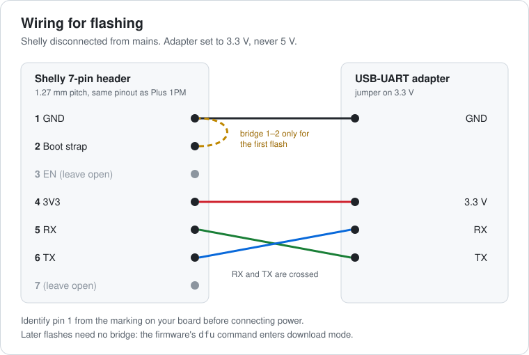

# Installation guide

This takes you from a stock Shelly 1PM Gen4 to a switch paired with your Hue
Bridge. Plan for an hour or two the first time; much of it is waiting for the
first build.

For using the switch once it's installed, see the [user manual](USER_MANUAL.md).

1. [Install the toolchain](#1-install-the-toolchain)
2. [Get the code and build](#2-get-the-code-and-build)
3. [Wire the adapter](#3-wire-the-adapter)
4. [Back up the stock firmware](#4-back-up-the-stock-firmware)
5. [Flash](#5-flash)
6. [Pair with Hue](#6-pair-with-hue)
7. [Test on mains, then install](#7-test-on-mains-then-install)

Later: [updating the firmware](#updating-the-firmware-later),
[restoring stock firmware](#restoring-stock-firmware).

## What you need

- **Shelly 1PM Gen4**, model S4SW-001P16EU. Other Shelly models use other pins.
- **USB-to-UART adapter with 3.3 V logic and a 3.3 V supply pin**, for example a
  CP2102 or CH340 board with a 3.3 V/5 V jumper.
- **Five jumper wires that fit a 1.27 mm header** (finer than the usual
  2.54 mm), or a 1.27 mm pin header or pogo pins.
- **A computer** with macOS or Linux. Everything here was done on macOS.
- **A Philips Hue Bridge.**
- Optional: a 470–1000 µF capacitor, to try the WiFi setup mode on the bench
  (see [Bench power](#bench-power)).

## Safety

- **The Shelly must be disconnected from mains whenever anything is connected to
  its header.** The header is not isolated from the mains side.
- On the bench, power it only from the adapter's **3.3 V** pin. 5 V can destroy
  the ESP32-C6.
- The relay does not switch on 3.3 V, so relay behaviour can only be checked on
  mains, with the adapter disconnected.
- Mains wiring in a bathroom may be subject to local regulations. If in doubt,
  have an electrician install it.

## 1. Install the toolchain

```bash
curl --proto '=https' --tlsv1.2 -sSf https://sh.rustup.rs | sh
```

```bash
cargo install ldproxy espflash cargo-espflash
```

```bash
pip3 install esptool
```

- The Rust nightly version is pinned in `rust-toolchain.toml` and installed
  automatically on the first build. Later nightlies failed to build `std` for
  this target (see the comment in that file).
- ESP-IDF v5.2.2 is pinned in `.cargo/config.toml` and is downloaded and built
  on the first build.
- Linux: install `libudev-dev` and `pkg-config` first.
- If Rust is also installed another way (e.g. Homebrew), make sure rustup's
  `~/.cargo/bin` comes first in your `PATH`. A stable `cargo` fails with
  "can't find crate for `core`".

## 2. Get the code and build

```bash
git clone https://github.com/weese/shelly-hue-fan.git
```

```bash
cd shelly-hue-fan
```

```bash
cargo build --release
```

The first build downloads and compiles ESP-IDF and takes a long while. Later
builds take seconds.

## 3. Wire the adapter



| Shelly header pin | Signal | Connect to |
|---|---|---|
| 1 | GND | adapter GND |
| 2 | Boot strap | bridge to pin 1, **first flash only** |
| 3 | EN | nothing |
| 4 | 3V3 | adapter 3.3 V |
| 5 | RX | adapter **TX** |
| 6 | TX | adapter **RX** |
| 7 | — | nothing |

The header is described in the
[blakadder template for the Shelly 1PM Gen4](https://templates.blakadder.com/shelly_1PM_Gen4.html).
Its pinout is the same as the Shelly Plus 1PM's, whose
[blakadder page](https://templates.blakadder.com/shelly_plus_1PM.html) has a
photo showing where pin 1 is. Find pin 1 on your board before you connect power.

Plug in the adapter and find its serial port:

```bash
ls /dev/cu.usbserial* /dev/ttyUSB* 2>/dev/null
```

The commands below use `$PORT`. Set it to the port you found, for example:

```bash
export PORT=/dev/cu.usbserial-210
```

## 4. Back up the stock firmware

This backup is your only way back to Shelly's own firmware. With pins 1 and 2
bridged, unplug and replug the adapter so the chip starts in download mode, then:

```bash
tools/backup_flash.sh "$PORT" shelly-1pm-gen4-stock-backup.bin
```

It reads the 8 MB flash in small chunks and retries failed ones, because a single
large read kept aborting over jumper wires. Keep the file private: it contains
your Shelly's device-specific data, and your WiFi password if you ever set the
Shelly up with the Shelly app. `.gitignore` excludes `*.bin` so it can't be
committed by accident.

## 5. Flash

```bash
cargo espflash flash --release --port "$PORT" --before no-reset --after no-reset --baud 115200 --partition-table partitions.csv --erase-parts otadata
```

Then unplug the adapter, **remove the bridge between pins 1 and 2**, and plug it
in again. The LED blinks three times quickly, then slowly: the firmware is
running and waiting to be added to a Hue Bridge.

You can check it over the [serial console](REFERENCE.md#serial-console):

```bash
python3 tools/console.py -p "$PORT" status
```

`factory_new=1 joined=0` is expected at this point.

`--before no-reset --after no-reset` is needed because the header has no reset
lines for the adapter. `--erase-parts otadata` clears the record of which
firmware slot to start, so the chip starts the slot that was just written (see
[updating the firmware later](#updating-the-firmware-later)).

## 6. Pair with Hue

Follow [Adding it to a Hue Bridge](USER_MANUAL.md#adding-it-to-a-hue-bridge) in
the user manual. This works on the bench; the adapter powers the Zigbee radio
fine.

## 7. Test on mains, then install

Disconnect the adapter. In a safe test setup, not yet in the wall box:

1. Hue on → the relay clicks and the fan runs.
2. Hue off → the fan keeps running for the run-on time, then stops.
3. If the fan runs when Hue says off, the relay polarity is inverted. Set
   *Relay output* to *Inverted* in
   [setup mode](USER_MANUAL.md#changing-settings-setup-mode).
4. Open setup mode once and confirm your phone can connect.

Then have it installed, and hand the [user manual](USER_MANUAL.md) to whoever
uses the bathroom.

## Bench power

Setup mode uses WiFi, which needs more power than a USB-UART adapter supplies:
on the bench the network appears, but the switch resets as soon as a phone
connects. On mains this isn't an issue. On the bench, a 470–1000 µF capacitor
across 3V3 and GND helps. Zigbee pairing works on adapter power alone.

## Updating the firmware later

No bridge between pins 1 and 2 is needed anymore. The firmware reboots into
download mode on a console command:

```bash
python3 tools/console.py -p "$PORT" dfu
```

```bash
cargo espflash flash --release --port "$PORT" --before no-reset --after no-reset --baud 115200 --partition-table partitions.csv --erase-parts otadata
```

Then **unplug and replug the adapter once**. The chip stays in download mode
across soft resets, and no software way out of it worked.

Flashing over serial keeps the Hue pairing and all settings, as long as
`partitions.csv` is unchanged.

Once installed, the setup page can install a firmware file instead (see
[Firmware update](USER_MANUAL.md#firmware-update)). Build the file with:

```bash
espflash save-image --chip esp32c6 --flash-size 8mb --partition-table partitions.csv target/riscv32imac-esp-espidf/release/shelly-hue-fan firmware.bin
```

The switch has two firmware slots. An upload through the setup page goes to the
slot not currently running and switches to it; a serial flash always writes the
first slot (`ota_0`). That is why the serial flash command erases `otadata`:
without it, a switch that last ran an uploaded firmware from `ota_1` would keep
starting the old firmware there. The console's `status` shows the running slot
as `slot=ota_0` or `slot=ota_1`.

## Restoring stock firmware

With the chip in download mode:

```bash
esptool --chip esp32c6 --port "$PORT" --before no-reset --after no-reset write-flash 0x0 shelly-1pm-gen4-stock-backup.bin
```

Not tested.
