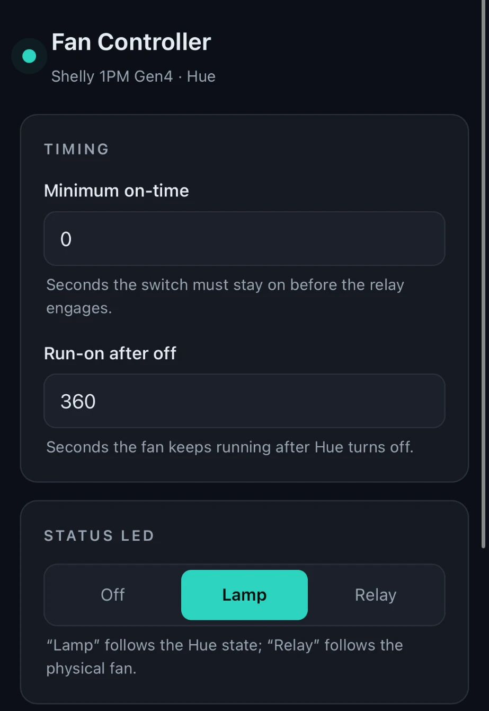
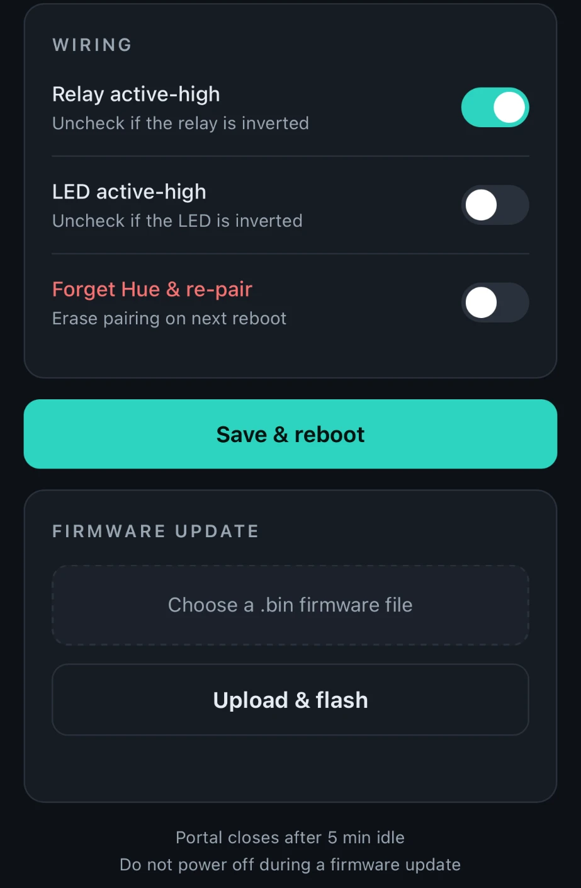

# Bathroom fan switch: user guide

This guide is for living with the installed switch. For building, flashing and
debugging, see the [README](../README.md).

> The firmware has been tested on the bench. Relay switching on mains has not
> been verified yet; check the README's status table before relying on it.

## What it does

The fan switch appears in the Philips Hue app as a light. It is in the same Hue
room or zone as the bathroom lamp, so anything that controls that room also
controls the fan: the Hue button, the app, automations, voice assistants.

- **Room on** → the fan starts.
- **Room off** → the fan keeps running for **6 minutes**, then stops.
- **Room on again within those 6 minutes** → the fan simply keeps running.

The Hue app shows the fan as *off* as soon as you switch off, even though the fan
is still running out its 6 minutes. That is expected.

After a power cut the fan stays off until it is switched on again. It keeps its
Hue pairing and its settings.

## The status light

The switch has a small LED.

| LED | Meaning |
|---|---|
| 3 quick blinks, then a few seconds of slow blinking | The switch just powered up. |
| Slow blinking | Not connected to a Hue Bridge; waiting to be added. |
| Fast blinking | Setup mode is open (see below). |
| On | The fan switch is on in Hue (default setting). |
| Off | The fan switch is off in Hue (default setting). |

The last two rows depend on the *Status LED* setting.

## Changing settings (setup mode)

The settings are changed from a phone through a small web page served by the
switch itself. No app or internet is needed.

**Open setup mode:** switch the bathroom fan circuit **off and on three times in
quick succession**, using the light switch or circuit breaker that powers it.
Leave it off for a few seconds each time so the switch really powers down, and
on for no more than about 5 seconds. After the third time the LED blinks fast.

**Connect:** on your phone, join the WiFi network **`Shelly-Fan-Setup`** (no
password). The settings page usually opens by itself. If it doesn't, open a
browser and go to **192.168.71.1**.

While your phone is on this network it has no internet and the Hue app does not
work. Switch back to your home WiFi when you're done.

### The settings

| Setting | What it does |
|---|---|
| **Minimum on-time** | Seconds the room must stay on before the fan starts. `0` starts it immediately. With e.g. `60`, a quick visit to the bathroom doesn't start the fan. |
| **Run-on after off** | Seconds the fan keeps running after the room is switched off. Default `360` (6 minutes). |
| **Status LED** | *Off*: LED always dark. *Lamp*: lit while Hue shows the fan as on. *Relay*: lit while the fan actually runs, including the run-on. |
| **Relay active-high** | Set once at installation. If the fan runs when Hue says *off* and stops when Hue says *on*, turn this off. |
| **LED active-high** | Set once at installation. If the LED is lit when it should be dark, change this. The default (off) is right for this switch. |
| **Forget Hue & re-pair** | Erases the connection to the Hue Bridge on the next restart. See below. |

Press **Save & reboot**. The switch stores the settings, restarts in normal
mode, and the new settings apply immediately.

If you don't touch the page for 5 minutes, the switch leaves setup mode on its
own without changing anything.

## Adding the switch to a Hue Bridge

1. In the Hue app: **Settings → Add device → Add light → Search**.
2. While the search runs, the switch's LED should be blinking slowly. It joins
   within a few seconds and appears as a new light.
3. Give it a name (e.g. *Bathroom fan*) and put it in the **same room or zone as
   the bathroom lamp**.

### Moving to a new bridge

Open setup mode, turn on **Forget Hue & re-pair**, press **Save & reboot**, then
add it on the new bridge as described above. This is expected to work but has
not been tried yet.

### Re-adding to the same bridge

If the light was deleted in the Hue app and you want to add it to the **same**
bridge again, *Forget Hue & re-pair* alone is not enough: the bridge remembers
the switch and quietly ignores it. It has to be given a new identity first,
which currently requires the serial console (`set mac`, see the
[README](../README.md#re-pairing-and-moving-to-another-bridge)).

## Firmware update

The setup page can install a new firmware file (`.bin`) built from this project:
choose the file, press **Upload & flash**, and **do not switch off the power**
until the switch has restarted.

This has not yet been tested end to end. Only use it if you know where the file
came from.

## Troubleshooting

| Problem | What to try |
|---|---|
| The fan keeps running after switching off | Normal for 6 minutes (or whatever *Run-on after off* is set to). |
| The fan does nothing at all | Check the circuit breaker. Look at the LED: slow blinking means the switch has lost its Hue connection. |
| The fan runs when Hue says off | *Relay active-high* is set the wrong way. Change it in setup mode. |
| Hue shows the fan as unreachable | Power to the switch is off, or it is too far from the nearest Hue lamp or bridge. |
| `Shelly-Fan-Setup` doesn't appear | The off/on cycles were too slow or too short. Try again: off a few seconds, on briefly, three times. |
| The settings page doesn't open | Make sure your phone is connected to `Shelly-Fan-Setup`, then go to `192.168.71.1` in a browser. |
| Hue can't find the switch | The LED must be blinking slowly while the app searches. If it was deleted from this bridge before, see *Re-adding to the same bridge*. |

## Safety

The switch is connected to mains voltage. Don't open the cover or the wall box
yourself. Installation and any changes to the wiring, especially in a bathroom,
should be done by a qualified electrician.
