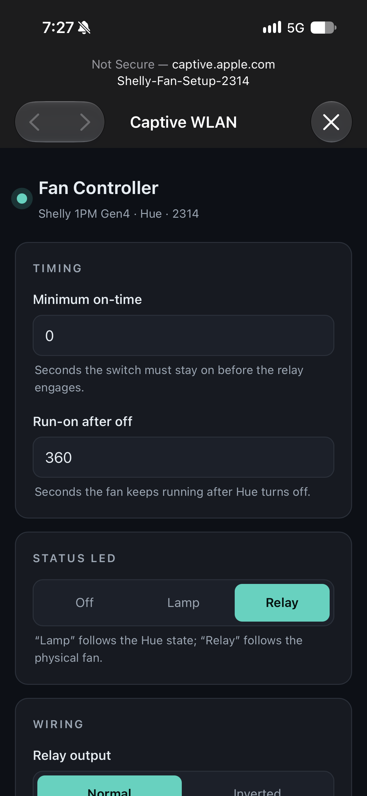
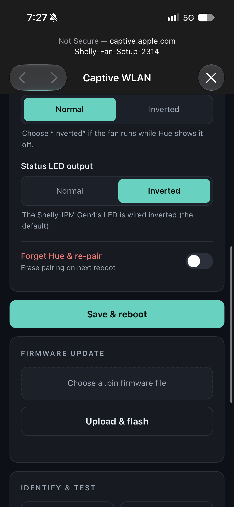

# User manual

For everyday use of a bathroom fan switch running this firmware. To flash the
firmware onto a Shelly, see the [installation guide](INSTALL.md).

- [What it does](#what-it-does)
- [The status light](#the-status-light)
- [Changing settings (setup mode)](#changing-settings-setup-mode)
- [Adding it to a Hue Bridge](#adding-it-to-a-hue-bridge)
- [Re-adding or moving to another bridge](#re-adding-or-moving-to-another-bridge)
- [Firmware update](#firmware-update)
- [Troubleshooting](#troubleshooting)

## What it does

The switch shows up in the Hue app as a light. It sits in the same Hue room or
zone as the bathroom lamp, so whatever controls that room also controls the fan:
the Hue button, the app, automations, voice assistants.

- **Room on** → the fan starts.
- **Room off** → the fan keeps running for **6 minutes**, then stops.
- **Room on again within those 6 minutes** → the fan simply keeps running.

The Hue app shows the fan as *off* as soon as you switch off, even though it is
still running out its 6 minutes. That is expected.

After a power cut the fan stays off until it is switched on again. Pairing and
settings are kept.

## The status light

| LED | Meaning |
|---|---|
| 3 quick blinks, then a few seconds of slow blinking | Just powered up. |
| Slow blinking (keeps going) | Not connected to a Hue Bridge; waiting to be added. |
| Fast blinking | Setup mode is open. |
| On / off | Follows the fan's on/off state in Hue (default setting). |

## Changing settings (setup mode)

Settings are changed from a phone, on a small web page served by the switch
itself. No app or internet is needed.

**1. Open setup mode.** Switch the fan's circuit **off and on three times in
quick succession**, using the switch or circuit breaker that powers it. Leave it
off for a few seconds each time so the switch really powers down, and on for no
more than about 5 seconds. After the third time the LED blinks fast.

**2. Connect.** On your phone, join the WiFi network **`Shelly-Fan-Setup-XXXX`**
(no password). `XXXX` is a code unique to your switch, so several switches in
setup mode don't get mixed up. The settings page usually opens by itself. If
not, open **192.168.71.1** in a browser.

While your phone is on this network it has no internet and the Hue app doesn't
work. Switch back to your home WiFi when you're done.

<table>
  <tr>
    <td valign="top"></td>
    <td valign="top"></td>
  </tr>
</table>

**3. Change settings and press Save & reboot.** The switch stores the settings
and restarts normally. If you do nothing for 5 minutes, it leaves setup mode by
itself and changes nothing.

| Setting | What it does |
|---|---|
| **Minimum on-time** | Seconds the room must stay on before the fan starts. `0` = immediately. With `60`, a quick visit doesn't start the fan. |
| **Run-on after off** | Seconds the fan keeps running after the room is switched off. Default `360` (6 minutes). |
| **Status LED** | *Off*: always dark. *Lamp*: lit while Hue shows the fan as on. *Relay*: lit while the fan actually runs, including the run-on. |
| **Relay output** | *Normal* or *Inverted*. Set once at installation: if the fan runs when Hue says off, choose *Inverted*. |
| **Status LED output** | *Normal* or *Inverted*. The default (*Inverted*) is right for this switch; change it only if the LED is lit when it should be dark. |
| **Forget Hue & re-pair** | Disconnects from the Hue Bridge so the switch can be added again. See [below](#re-adding-or-moving-to-another-bridge). |

**Identify & test**, at the bottom of the page, has two buttons that act
immediately and change no settings:

- **Flash LED**: this switch's LED gives long flashes for 10 seconds, so you can
  see which switch you're connected to.
- **Relay**: switches the fan on and off directly, for testing. It starts off
  each time setup mode opens.

## Adding it to a Hue Bridge

1. In the Hue app: **Settings → Add device → Add light → Search**.
2. While the search runs, the switch's LED should be blinking slowly. It joins
   within a few seconds and appears as a new light.
3. Give it a name (e.g. *Bathroom fan*) and put it in the **same room or zone as
   the bathroom lamp**. Check that your Hue button controls that room or zone.

## Re-adding or moving to another bridge

Open setup mode, turn on **Forget Hue & re-pair**, press **Save & reboot**. A few
seconds after the restart the switch disconnects from Hue, restarts again and
blinks slowly. Then add it as described above, on the same bridge or a new one.

The switch comes back as a new light, because a Hue Bridge won't take back a
light it has seen before. The old entry in the Hue app becomes unreachable;
delete it.

## Firmware update

The setup page can install a new firmware file (`.bin`): choose the file, press
**Upload & flash**, and **don't switch off the power** until the switch has
restarted. Settings and the Hue pairing are kept.

Only use files from this project's
[releases page](https://github.com/weese/shelly-hue-fan/releases) or from
someone you trust. The upload takes about 10 seconds.

## Troubleshooting

| Problem | What to try |
|---|---|
| The fan keeps running after switching off | Normal for 6 minutes (or whatever *Run-on after off* is set to). |
| The fan does nothing | Check the circuit breaker. Slow blinking means the switch has lost its Hue connection. |
| The fan runs when Hue says off | In setup mode, switch *Relay output* to the other setting. |
| Hue shows the fan as unreachable | The switch has no power, or it is too far from the nearest Hue lamp or the bridge. |
| `Shelly-Fan-Setup-…` doesn't appear | The off/on cycles were too slow or too short. Try again: off a few seconds, on briefly, three times. |
| The settings page doesn't open | Check the phone is connected to `Shelly-Fan-Setup-…`, then open `192.168.71.1`. |
| Several switches are in setup mode | Each has its own network name. On the page, **Flash LED** shows which switch you're on. |
| Hue can't find the switch | The LED must be blinking slowly while the app searches. If it was added to this bridge before, use *Forget Hue & re-pair* first. |

The switch is connected to mains. Don't open the cover or the wall box yourself;
leave changes to the wiring to an electrician.
